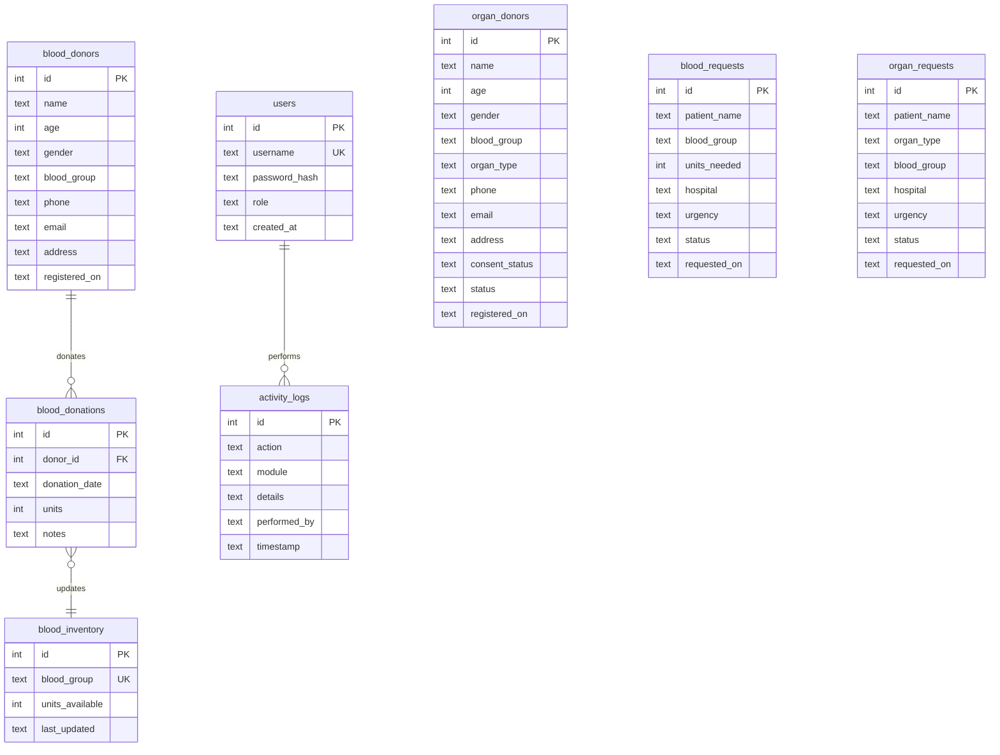
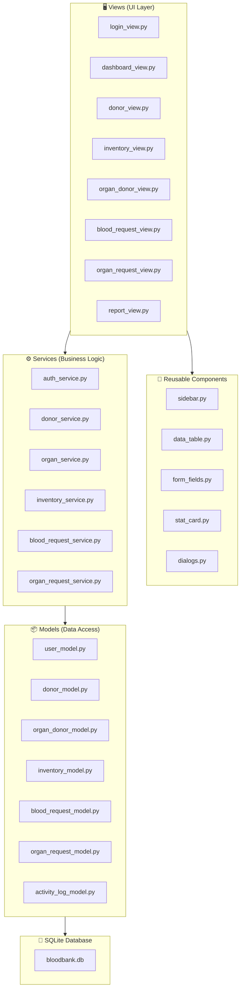

# 🏥 Blood Bank & Organ Donors Management System — Final Implementation Plan

> **Team Size:** 2 members · **Timeline:** 1–2 days · **Deliverable:** Windows `.exe` file
> **Tech Stack:** Python 3.11+ · CustomTkinter · SQLite · bcrypt · PyInstaller

---

## 1. Final Folder Structure (Modular Architecture)

```
BloodBank-OrganDonor/
│
├── main.py                        # App entry point
├── config.py                      # App-wide configuration & constants
├── requirements.txt               # Python dependencies
├── README.md                      # Project documentation
├── .gitignore                     # Git ignore rules
│
├── database/
│   ├── __init__.py                # Package init — exports get_connection()
│   ├── connection.py              # DB connection manager (AppData path logic)
│   ├── schema.sql                 # All CREATE TABLE statements
│   └── seed.py                    # Default admin user + blood group inventory
│
├── models/
│   ├── __init__.py
│   ├── user_model.py              # CRUD for users table
│   ├── donor_model.py             # CRUD for blood_donors + blood_donations
│   ├── organ_donor_model.py       # CRUD for organ_donors
│   ├── inventory_model.py         # CRUD for blood_inventory
│   ├── blood_request_model.py     # CRUD for blood_requests
│   ├── organ_request_model.py     # CRUD for organ_requests
│   └── activity_log_model.py      # CRUD for activity_logs
│
├── services/
│   ├── __init__.py
│   ├── auth_service.py            # Login/logout, password hashing (bcrypt)
│   ├── donor_service.py           # Blood donor business logic
│   ├── organ_service.py           # Organ donor business logic
│   ├── inventory_service.py       # Blood stock management logic
│   ├── blood_request_service.py   # Blood request processing
│   ├── organ_request_service.py   # Organ request processing
│   └── export_service.py          # CSV export logic
│
├── views/
│   ├── __init__.py
│   ├── login_view.py              # Login screen
│   ├── dashboard_view.py          # Main dashboard with stats
│   │
│   ├── blood/
│   │   ├── __init__.py
│   │   ├── donor_view.py          # Blood donor CRUD screen
│   │   └── inventory_view.py      # Blood inventory screen
│   │
│   ├── organ/
│   │   ├── __init__.py
│   │   └── organ_donor_view.py    # Organ donor CRUD screen
│   │
│   ├── requests/
│   │   ├── __init__.py
│   │   ├── blood_request_view.py  # Blood request screen
│   │   └── organ_request_view.py  # Organ request screen
│   │
│   └── reports/
│       ├── __init__.py
│       └── report_view.py         # Reports & CSV export screen
│
├── components/
│   ├── __init__.py
│   ├── sidebar.py                 # Left navigation sidebar
│   ├── navbar.py                  # Top navigation bar
│   ├── data_table.py              # Reusable table/treeview widget
│   ├── form_fields.py             # Reusable form input helpers
│   ├── stat_card.py               # Dashboard stat card widget
│   └── dialogs.py                 # Confirm/alert/input dialog helpers
│
├── assets/
│   ├── images/                    # App images (splash, banners)
│   ├── icons/                     # Menu/toolbar icons
│   └── logo.ico                   # App icon for .exe
│
├── utils/
│   ├── __init__.py
│   ├── validators.py              # Input validation (phone, email, age, etc.)
│   ├── helpers.py                 # Date formatting, ID generation, etc.
│   └── constants.py               # Blood groups list, organ types, urgency levels
│
├── tests/
│   ├── __init__.py
│   ├── test_auth.py               # Auth service tests
│   ├── test_donors.py             # Donor model/service tests
│   └── test_inventory.py          # Inventory tests
│
└── dist/                          # ← PyInstaller output (generated, git-ignored)
    └── BloodBankManager.exe
```

> [!NOTE]
> **Why this structure matters for your lab project:**
> - **Separation of Concerns** — Models (data), Services (logic), Views (UI), Components (reusable widgets)
> - **Demonstrates Software Engineering principles** — MVC pattern, modularity, testability
> - Your professor will see professional-grade project organization

---

## 2. Database Schema (8 Tables)

Improvements over the original design based on analysis:
1. ✅ **Separate `blood_donations` table** — tracks full donation history, not just last date
2. ✅ **UNIQUE constraint on `blood_group`** in inventory — one row per blood type
3. ✅ **Split `blood_requests` and `organ_requests`** — cleaner logic, simpler reporting
4. ✅ **Consent tracking** for organ donors — `consent_status` with CHECK constraint
5. ✅ **Activity logs** — audit trail of important actions
6. ✅ **Hashed passwords** — bcrypt, never plaintext



### Complete SQL Schema (`database/schema.sql`)

```sql
-- ============================================
-- Blood Bank & Organ Donors Management System
-- Database Schema — SQLite
-- ============================================

-- 1. Users (Admin authentication)
CREATE TABLE IF NOT EXISTS users (
    id INTEGER PRIMARY KEY AUTOINCREMENT,
    username TEXT UNIQUE NOT NULL,
    password_hash TEXT NOT NULL,
    role TEXT NOT NULL DEFAULT 'admin',
    created_at TEXT DEFAULT CURRENT_TIMESTAMP
);

-- 2. Blood Donors
CREATE TABLE IF NOT EXISTS blood_donors (
    id INTEGER PRIMARY KEY AUTOINCREMENT,
    name TEXT NOT NULL,
    age INTEGER CHECK(age >= 18 AND age <= 65),
    gender TEXT CHECK(gender IN ('Male', 'Female', 'Other')),
    blood_group TEXT NOT NULL,
    phone TEXT,
    email TEXT,
    address TEXT,
    registered_on TEXT DEFAULT CURRENT_TIMESTAMP
);

-- 3. Blood Donations (History — linked to donors)
CREATE TABLE IF NOT EXISTS blood_donations (
    id INTEGER PRIMARY KEY AUTOINCREMENT,
    donor_id INTEGER NOT NULL,
    donation_date TEXT NOT NULL DEFAULT CURRENT_TIMESTAMP,
    units INTEGER NOT NULL DEFAULT 1,
    notes TEXT,
    FOREIGN KEY (donor_id) REFERENCES blood_donors(id) ON DELETE CASCADE
);

-- 4. Blood Inventory (One row per blood group)
CREATE TABLE IF NOT EXISTS blood_inventory (
    id INTEGER PRIMARY KEY AUTOINCREMENT,
    blood_group TEXT UNIQUE NOT NULL,
    units_available INTEGER NOT NULL DEFAULT 0,
    last_updated TEXT DEFAULT CURRENT_TIMESTAMP
);

-- 5. Organ Donors (With consent tracking)
CREATE TABLE IF NOT EXISTS organ_donors (
    id INTEGER PRIMARY KEY AUTOINCREMENT,
    name TEXT NOT NULL,
    age INTEGER,
    gender TEXT CHECK(gender IN ('Male', 'Female', 'Other')),
    blood_group TEXT,
    organ_type TEXT NOT NULL,
    phone TEXT,
    email TEXT,
    address TEXT,
    consent_status TEXT NOT NULL DEFAULT 'Pending'
        CHECK(consent_status IN ('Pending', 'Consented', 'Withdrawn')),
    status TEXT NOT NULL DEFAULT 'Available'
        CHECK(status IN ('Available', 'Matched', 'Donated', 'Unavailable')),
    registered_on TEXT DEFAULT CURRENT_TIMESTAMP
);

-- 6. Blood Requests
CREATE TABLE IF NOT EXISTS blood_requests (
    id INTEGER PRIMARY KEY AUTOINCREMENT,
    patient_name TEXT NOT NULL,
    blood_group TEXT NOT NULL,
    units_needed INTEGER NOT NULL DEFAULT 1,
    hospital TEXT,
    urgency TEXT NOT NULL DEFAULT 'Normal'
        CHECK(urgency IN ('Normal', 'Urgent', 'Critical')),
    status TEXT NOT NULL DEFAULT 'Pending'
        CHECK(status IN ('Pending', 'Approved', 'Fulfilled', 'Rejected')),
    requested_on TEXT DEFAULT CURRENT_TIMESTAMP
);

-- 7. Organ Requests
CREATE TABLE IF NOT EXISTS organ_requests (
    id INTEGER PRIMARY KEY AUTOINCREMENT,
    patient_name TEXT NOT NULL,
    organ_type TEXT NOT NULL,
    blood_group TEXT,
    hospital TEXT,
    urgency TEXT NOT NULL DEFAULT 'Normal'
        CHECK(urgency IN ('Normal', 'Urgent', 'Critical')),
    status TEXT NOT NULL DEFAULT 'Pending'
        CHECK(status IN ('Pending', 'Matched', 'Fulfilled', 'Rejected')),
    requested_on TEXT DEFAULT CURRENT_TIMESTAMP
);

-- 8. Activity Logs (Audit trail)
CREATE TABLE IF NOT EXISTS activity_logs (
    id INTEGER PRIMARY KEY AUTOINCREMENT,
    action TEXT NOT NULL,
    module TEXT NOT NULL,
    details TEXT,
    performed_by TEXT,
    timestamp TEXT DEFAULT CURRENT_TIMESTAMP
);
```

---

## 3. Security Implementation

> [!CAUTION]
> **Never store plaintext passwords.** The original guide stored `"admin123"` in plain text. We fix that here.

### Password Hashing with bcrypt

```python
# services/auth_service.py
import bcrypt

def hash_password(plain_password: str) -> str:
    """Hash a password using bcrypt."""
    salt = bcrypt.gensalt()
    return bcrypt.hashpw(plain_password.encode('utf-8'), salt).decode('utf-8')

def verify_password(plain_password: str, hashed_password: str) -> bool:
    """Verify a password against its bcrypt hash."""
    return bcrypt.checkpw(
        plain_password.encode('utf-8'),
        hashed_password.encode('utf-8')
    )
```

### Database Location — AppData (Not Next to .exe)

```python
# database/connection.py
import os
import sys
import sqlite3

def get_db_path() -> str:
    """Get the database file path in user's AppData directory."""
    if sys.platform == 'win32':
        app_data = os.environ.get('LOCALAPPDATA', os.path.expanduser('~'))
        db_dir = os.path.join(app_data, 'BloodBankManager')
    else:
        db_dir = os.path.join(os.path.expanduser('~'), '.bloodbankmanager')

    os.makedirs(db_dir, exist_ok=True)
    return os.path.join(db_dir, 'bloodbank.db')

def get_connection() -> sqlite3.Connection:
    """Get a database connection with foreign keys enabled."""
    conn = sqlite3.connect(get_db_path())
    conn.execute("PRAGMA foreign_keys = ON")
    conn.row_factory = sqlite3.Row  # Access columns by name
    return conn
```

### Security Checklist

| Practice | Implementation |
|----------|---------------|
| Password hashing | bcrypt (never plaintext) |
| SQL injection prevention | Parameterized queries (`?` placeholders) everywhere |
| Input validation | `utils/validators.py` — phone, email, age, blood group |
| Default credentials | Seed admin with hashed password, prompt to change on first login |
| DB file protection | Stored in AppData, not in read-only Program Files |
| Form validation | Client-side validation before any DB write |

---

## 4. Feature Prioritization

| Feature | Priority | Commit # | Owner |
|---------|----------|----------|-------|
| Project setup + folder structure | 🔴 Must have | 1 | Member A |
| Database layer (connection + schema + seed) | 🔴 Must have | 2 | Member A |
| Reusable UI components (sidebar, table, forms) | 🔴 Must have | 3 | Member B |
| Auth service + Login screen | 🔴 Must have | 4 | Member A |
| Dashboard with stat cards | 🔴 Must have | 5 | Member B |
| Blood Donor CRUD | 🔴 Must have | 6 | Member A |
| Blood Inventory management | 🔴 Must have | 7 | Member A |
| Organ Donor CRUD (with consent) | 🔴 Must have | 8 | Member B |
| Blood Requests | 🔴 Must have | 9 | Member A |
| Organ Requests | 🔴 Must have | 10 | Member B |
| Search & filtering | 🔴 Must have | 11 | Member A |
| Reports + CSV export | 🟡 Optional | 12 | Member B |
| Activity logs integration | 🟡 Optional | 13 | Member A |
| Final polish + testing | 🔴 Must have | 14 | Both |
| PyInstaller → .exe packaging | 🔴 Must have | 15 | Member B |
| Charts (matplotlib) | 🟢 Postpone | — | — |
| PDF reports | 🟢 Postpone | — | — |
| Email notifications | 🟢 Postpone | — | — |

---

## 5. Tech Stack & Dependencies

### `requirements.txt`

```
customtkinter==5.2.1
bcrypt>=4.0.0
Pillow>=10.0.0
pyinstaller>=6.0
```

> [!TIP]
> **Minimal dependencies = easier packaging.** We removed `matplotlib` from the must-have list. Add it only if you get to charts. Fewer packages = smaller `.exe` and fewer PyInstaller issues.

### Why Each Dependency

| Package | Purpose | Size Impact |
|---------|---------|-------------|
| `customtkinter` | Modern-looking GUI widgets | Small |
| `bcrypt` | Secure password hashing | Small |
| `Pillow` | Image loading for icons/logos | Medium |
| `pyinstaller` | Dev-only — builds the .exe | Not bundled |
| `sqlite3` | Database | Built into Python (free) |
| `tkinter` | Base GUI framework | Built into Python (free) |

---

## 6. Architecture Pattern — MVC + Services



**Data flow:** User clicks button in **View** → View calls **Service** → Service calls **Model** → Model executes SQL on **Database** → result flows back up

---

## 7. Work Division — 2 Members

### 👤 Member A — Backend Lead + Blood Modules

| Day | Tasks | Hours |
|-----|-------|-------|
| Day 1 Morning | Commit 1: Project setup, folder structure, .gitignore, config.py | 1h |
| Day 1 Morning | Commit 2: Database layer (connection.py, schema.sql, seed.py) | 2h |
| Day 1 Afternoon | Commit 4: Auth service + login integration | 2h |
| Day 1 Evening | Commit 6: Blood Donor CRUD (model + service + view) | 3h |
| Day 1 Night | Commit 7: Blood Inventory management | 2h |
| Day 2 Morning | Commit 9: Blood Requests (model + service + view) | 2.5h |
| Day 2 Afternoon | Commit 11: Search & filtering | 2h |
| Day 2 Evening | Commit 14: Testing + bug fixes | 1.5h |

### 👤 Member B — Frontend Lead + Organ Modules

| Day | Tasks | Hours |
|-----|-------|-------|
| Day 1 Morning | Commit 3: Reusable components (sidebar, data_table, form_fields, stat_card, dialogs) | 3h |
| Day 1 Afternoon | Commit 5: Dashboard view with stat cards | 2h |
| Day 1 Evening | Commit 8: Organ Donor CRUD with consent (model + service + view) | 3h |
| Day 2 Morning | Commit 10: Organ Requests (model + service + view) | 2.5h |
| Day 2 Afternoon | Commit 12: Reports + CSV export | 2h |
| Day 2 Evening | Commit 14: UI polish + testing | 1h |
| Day 2 Night | Commit 15: PyInstaller packaging → .exe | 1h |

> [!IMPORTANT]
> **Member A starts first** (project setup + database). Member B can begin components in parallel immediately — they don't depend on the database being done.

---

## 8. Step-by-Step Commit Plan

Each section below = one Git commit. Build the project incrementally.

---

### Commit 1 — Project Setup & Configuration
**Owner:** Member A · **Time:** ~1 hour

**Files to create:**
- `main.py` — Minimal app entry point (empty window)
- `config.py` — App name, version, window size, blood groups, organ types
- `requirements.txt` — Dependencies
- `.gitignore` — Python ignores + dist/ + *.db
- `README.md` — Project title + team info
- All `__init__.py` files in every package folder
- `utils/constants.py` — Blood groups list, organ types, urgency levels

```bash
git init
git add .
git commit -m "feat: initial project setup with modular folder structure and config"
```

---

### Commit 2 — Database Layer
**Owner:** Member A · **Time:** ~2 hours

**Files to create:**
- `database/connection.py` — AppData path logic, `get_connection()`, `get_db_path()`
- `database/schema.sql` — All 8 CREATE TABLE statements (from Section 2)
- `database/seed.py` — Insert default admin (hashed password), 8 blood group inventory rows
- `database/__init__.py` — Export `initialize_db()`, `get_connection()`

```bash
git add database/
git commit -m "feat: database layer with schema, connection manager, and seed data"
```

---

### Commit 3 — Reusable UI Components
**Owner:** Member B · **Time:** ~3 hours

**Files to create:**
- `components/sidebar.py` — Left nav with menu items, highlight active item
- `components/navbar.py` — Top bar with app title + logout button
- `components/data_table.py` — Reusable Treeview wrapper (sortable columns, selection, pagination placeholder)
- `components/form_fields.py` — Helper functions: `create_label_entry()`, `create_dropdown()`, `create_date_picker()`
- `components/stat_card.py` — Dashboard stat card (icon + number + label)
- `components/dialogs.py` — `confirm_dialog()`, `alert_dialog()`, `input_dialog()`

```bash
git add components/
git commit -m "feat: reusable UI components — sidebar, data table, form fields, dialogs"
```

---

### Commit 4 — Authentication (Login Screen)
**Owner:** Member A · **Time:** ~2 hours

**Files to create:**
- `models/user_model.py` — `get_user_by_username()`, `create_user()`, `update_password()`
- `services/auth_service.py` — `hash_password()`, `verify_password()`, `login()`, `get_current_user()`
- `views/login_view.py` — Username/password fields, login button, error messages
- Update `main.py` — Show login → on success show dashboard

```bash
git add models/user_model.py services/auth_service.py views/login_view.py main.py
git commit -m "feat: user authentication with bcrypt password hashing and login screen"
```

---

### Commit 5 — Dashboard
**Owner:** Member B · **Time:** ~2 hours

**Files to create:**
- `views/dashboard_view.py` — Stat cards (total blood donors, total organ donors, blood units, pending requests), quick action buttons

```bash
git add views/dashboard_view.py
git commit -m "feat: dashboard with summary statistics and navigation"
```

---

### Commit 6 — Blood Donor CRUD
**Owner:** Member A · **Time:** ~3 hours

**Files to create:**
- `models/donor_model.py` — `add_donor()`, `get_all_donors()`, `get_donor_by_id()`, `update_donor()`, `delete_donor()`, `record_donation()`, `get_donation_history()`
- `services/donor_service.py` — Validation + business logic wrapper
- `views/blood/donor_view.py` — Add form, table of all donors, edit/delete buttons, donation recording

```bash
git add models/donor_model.py services/donor_service.py views/blood/
git commit -m "feat: blood donor CRUD with donation history tracking"
```

---

### Commit 7 — Blood Inventory
**Owner:** Member A · **Time:** ~2 hours

**Files to create:**
- `models/inventory_model.py` — `get_all_inventory()`, `update_stock()`, `increment_units()`, `decrement_units()`
- `services/inventory_service.py` — Stock validation, auto-update on donation
- `views/blood/inventory_view.py` — Table of 8 blood groups with stock levels, +/- buttons

```bash
git add models/inventory_model.py services/inventory_service.py views/blood/inventory_view.py
git commit -m "feat: blood inventory management with stock tracking per blood group"
```

---

### Commit 8 — Organ Donor CRUD (with Consent)
**Owner:** Member B · **Time:** ~3 hours

**Files to create:**
- `models/organ_donor_model.py` — CRUD + `update_consent_status()`, `get_by_organ_type()`
- `services/organ_service.py` — Validation, consent logic
- `views/organ/organ_donor_view.py` — Add form (with consent dropdown), table, edit/delete, consent status badge

```bash
git add models/organ_donor_model.py services/organ_service.py views/organ/
git commit -m "feat: organ donor CRUD with consent status tracking"
```

---

### Commit 9 — Blood Requests
**Owner:** Member A · **Time:** ~2.5 hours

**Files to create:**
- `models/blood_request_model.py` — CRUD + `get_by_status()`, `get_by_urgency()`
- `services/blood_request_service.py` — Request processing, status updates
- `views/requests/blood_request_view.py` — Request form, table with status badges, approve/reject buttons

```bash
git add models/blood_request_model.py services/blood_request_service.py views/requests/blood_request_view.py
git commit -m "feat: blood request management with urgency prioritization"
```

---

### Commit 10 — Organ Requests
**Owner:** Member B · **Time:** ~2.5 hours

**Files to create:**
- `models/organ_request_model.py` — CRUD + filtering
- `services/organ_request_service.py` — Request logic
- `views/requests/organ_request_view.py` — Request form, table, status management

```bash
git add models/organ_request_model.py services/organ_request_service.py views/requests/organ_request_view.py
git commit -m "feat: organ request management with matching workflow"
```

---

### Commit 11 — Search & Filtering
**Owner:** Member A · **Time:** ~2 hours

**Updates to existing views:**
- Add search bar + filter dropdowns to `donor_view.py`, `organ_donor_view.py`, request views
- Add search methods to models: `search_donors(name, blood_group)`, `search_organ_donors(name, organ_type)`

```bash
git add models/ views/
git commit -m "feat: search and filtering across all modules"
```

---

### Commit 12 — Reports & CSV Export
**Owner:** Member B · **Time:** ~2 hours

**Files to create:**
- `services/export_service.py` — `export_to_csv(data, filename)` for any module
- `views/reports/report_view.py` — Report selection, date range, export button

```bash
git add services/export_service.py views/reports/
git commit -m "feat: reports screen with CSV export functionality"
```

---

### Commit 13 — Activity Logs (Optional)
**Owner:** Member A · **Time:** ~1.5 hours

**Files to create:**
- `models/activity_log_model.py` — `log_action()`, `get_recent_logs()`
- Integrate logging calls into services (donor added, request approved, etc.)

```bash
git add models/activity_log_model.py services/
git commit -m "feat: activity logging for audit trail"
```

---

### Commit 14 — Polish, Validation & Testing
**Owner:** Both · **Time:** ~2 hours

**Files to create/update:**
- `utils/validators.py` — `validate_phone()`, `validate_email()`, `validate_age()`, `validate_blood_group()`
- `tests/test_auth.py`, `tests/test_donors.py`, `tests/test_inventory.py` — Basic unit tests
- Fix bugs, improve error messages, test all flows

```bash
git add utils/ tests/
git commit -m "feat: input validation, error handling, and unit tests"
```

---

### Commit 15 — Package as .exe
**Owner:** Member B · **Time:** ~1 hour

**Command:**
```bash
pyinstaller --noconfirm --onefile --windowed ^
    --name "BloodBankManager" ^
    --icon=assets/logo.ico ^
    --add-data "database/schema.sql;database" ^
    --add-data "assets;assets" ^
    main.py
```

> [!IMPORTANT]
> **PyInstaller Notes:**
> - `--add-data "source;destination"` bundles non-Python files (SQL schema, icons)
> - Use `;` as separator on Windows (`:` on Mac/Linux)
> - The `.exe` appears in `dist/BloodBankManager.exe`
> - Test it on a different PC or clean folder before submitting

**For reading bundled files inside the .exe, use this in `config.py`:**
```python
import sys
import os

def resource_path(relative_path):
    """Get absolute path to resource — works for dev and PyInstaller .exe"""
    if hasattr(sys, '_MEIPASS'):
        return os.path.join(sys._MEIPASS, relative_path)
    return os.path.join(os.path.abspath("."), relative_path)
```

```bash
# Build the .exe
pyinstaller --noconfirm --onefile --windowed --name "BloodBankManager" main.py

# Test
dist\BloodBankManager.exe

git add .
git commit -m "build: package application as Windows executable with PyInstaller"
```

---

## 9. Git Workflow for 2 Members

```bash
# Initial setup (Member A)
git init
git remote add origin <your-github-repo-url>

# Both members work on feature branches
git checkout -b feature/blood-donor-crud    # Member A
git checkout -b feature/organ-donor-crud    # Member B

# After completing a feature
git add .
git commit -m "feat: blood donor CRUD with donation history"
git push origin feature/blood-donor-crud

# Merge into main
git checkout main
git pull origin main
git merge feature/blood-donor-crud
git push origin main
```

> [!TIP]
> **Simpler alternative (for 2 people, tight deadline):** Both commit directly to `main` branch but communicate before pushing to avoid conflicts. Run `git pull` before each `git push`.

---

## 10. Key Application Screens (UI Wireframes)

### Login Screen
```
┌─────────────────────────────────────────────┐
│                                             │
│        🏥 Blood Bank & Organ Donors         │
│          Management System                  │
│                                             │
│        ┌─────────────────────┐              │
│        │ Username            │              │
│        └─────────────────────┘              │
│        ┌─────────────────────┐              │
│        │ Password            │              │
│        └─────────────────────┘              │
│                                             │
│        [ 🔐 Login ]                         │
│                                             │
└─────────────────────────────────────────────┘
```

### Main App Layout
```
┌──────────┬──────────────────────────────────┐
│ SIDEBAR  │  NAVBAR (Title + Logout)         │
│          ├──────────────────────────────────┤
│ Dashboard│                                  │
│ ─────── │  CONTENT AREA                    │
│ Blood    │                                  │
│  Donors  │  (Changes based on sidebar       │
│  Inventory│   selection)                    │
│ ─────── │                                  │
│ Organ    │  ┌─────┐ ┌─────┐ ┌─────┐       │
│  Donors  │  │Stats│ │Stats│ │Stats│        │
│ ─────── │  └─────┘ └─────┘ └─────┘        │
│ Requests │                                  │
│  Blood   │  ┌──────────────────────┐        │
│  Organ   │  │   Data Table         │        │
│ ─────── │  │   with records       │        │
│ Reports  │  └──────────────────────┘        │
│          │                                  │
│ Logout   │  [ Add ] [ Edit ] [ Delete ]     │
└──────────┴──────────────────────────────────┘
```

---

## 11. How to Run During Development

```bash
# 1. Clone the repo
git clone <repo-url>
cd BloodBank-OrganDonor

# 2. Create virtual environment
python -m venv venv
venv\Scripts\activate

# 3. Install dependencies
pip install -r requirements.txt

# 4. Run the app
python main.py

# 5. Run tests
python -m pytest tests/ -v
```

---

## 12. Checklist Before Submission

- [ ] All 8 database tables created and working
- [ ] Login works with hashed password
- [ ] Blood Donor: Add / View / Edit / Delete works
- [ ] Organ Donor: Add / View / Edit / Delete works (with consent)
- [ ] Blood Inventory: Shows all 8 blood groups with stock
- [ ] Blood Requests: Create / View / Approve / Reject
- [ ] Organ Requests: Create / View / Match / Reject
- [ ] Dashboard shows correct counts
- [ ] Search works across donors and requests
- [ ] Input validation prevents bad data
- [ ] `.exe` runs on a PC without Python installed
- [ ] `.exe` creates database on first run
- [ ] No hardcoded file paths — uses AppData
- [ ] README.md has project overview + team details
- [ ] All commits have meaningful messages

---

> [!IMPORTANT]
> **⏳ Next Step:** Review this plan. Once you confirm, I will start building the project **commit by commit** — creating every file, testing as we go, and giving you Git commands to run after each feature.

