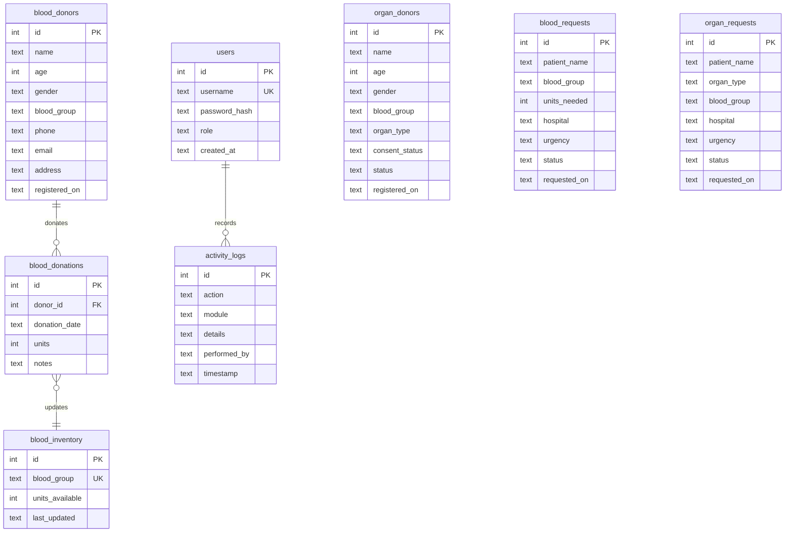

# 🏥 LifeLink — Blood Bank & Organ Donors Management System

> **Software Engineering Lab Project**  
> A high-performance, clinical-grade desktop application for blood bank inventory management, organ donor pledge tracking, and emergency medical requisition routing. Built with **Python 3.11+**, **CustomTkinter**, **SQLite**, and distributed as a standalone **Windows `.exe`**.

---

## 🌟 Key Highlights & Engineering Features

- 🖥️ **Modern Desktop UI:** Designed with an ultra-sleek dark theme, subtle glassmorphism borders, animated counters, smooth error shaking, and live digital clocks.
- 🔐 **Enterprise Role-Based Authentication:**
  - Salted and hashed passwords utilizing the industry-standard **`bcrypt`** algorithm.
  - Multi-user support with built-in role separation (**Administrator**, **Medical Staff**, and **Medical Officers**).
  - Ability to register new staff accounts on the fly right from the portal.
- 🩸 **Complete Blood Bank Lifecycle:**
  - Donor registry with biological constraints (age 18–65, valid contact info).
  - Historical donation audit log maintaining timestamps and units contributed.
  - Auto-updating inventory reserves across all 8 major blood groups (`A+`, `A-`, `B+`, `B-`, `AB+`, `AB-`, `O+`, `O-`).
- 🫀 **Organ Donor Registry & Consent Tracking:**
  - Dedicated pledge management supporting Kidney, Liver, Heart, Lungs, Pancreas, Cornea, etc.
  - Explicit **Legal Consent Tracking** (`Pending`, `Consented`, `Withdrawn`) to ensure bioethical and legal compliance.
- 🚑 **Emergency Medical Requisitions:**
  - Urgency categorization (`Normal`, `Urgent`, `Critical`) for both blood and organ transplant queues.
  - Clinical status pipeline (`Pending` → `Approved` / `Matched` → `Fulfilled` / `Rejected`).
- 📊 **Clinical Auditing & One-Click CSV Export:**
  - Full audit trail (`activity_logs`) recording administrative events with timestamps.
  - Instant CSV export for donors, donations, stock levels, and requisitions.
- 📦 **Zero-Config Windows Deployment:**
  - Single standalone `.exe` package generated with PyInstaller.
  - No Python runtime or manual setup required on client PCs.

---

## 🔐 Credentials & Access Control

The database is automatically initialized and pre-seeded on first launch. You can use the **⚡ Demo Quick Fill** buttons on the login screen or register your own staff account.

| Username | Password | Role | Permissions |
|:---|:---|:---|:---|
| `admin` | `admin123` | **Administrator** | Full access to manage donors, inventory, requests, audits, and users |
| `staff` | `staff123` | **Medical Staff** | Day-to-day operations, donor registration, and status workflows |

> [!TIP]
> **Need a new user?** Simply switch the tab on the login screen to **"Create Staff Account"** to register a new user into the database!

---

## 🏗️ System Architecture & Modularity

The application follows clean **MVC (Model-View-Controller) / Service-Oriented Architecture** principles:

```
BloodBank-OrganDonor/
│
├── main.py                        # Application entry point & window controller
├── config.py                      # Centralized design tokens, constants & paths
├── requirements.txt               # Production dependencies
├── README.md                      # Comprehensive project documentation
│
├── database/
│   ├── connection.py              # SQLite connection manager & AppData persistence
│   ├── schema.sql                 # 8 normalized relational database tables
│   └── seed.py                    # Default data seeder (bcrypt admin & stock)
│
├── models/                        # Data Access Layer (parameterized queries)
│   ├── user_model.py              # Account & credential queries
│   ├── donor_model.py             # Blood donor & donation audit models
│   ├── inventory_model.py         # Stock level calculations
│   ├── organ_donor_model.py       # Organ registry & consent status queries
│   ├── blood_request_model.py     # Blood demand records
│   ├── organ_request_model.py     # Organ match queues
│   └── activity_log_model.py      # System audit logging
│
├── services/                      # Business Logic & Validation Layer
│   ├── auth_service.py            # Bcrypt hashing, session state & registration
│   ├── donor_service.py           # Biological verification & donation pipeline
│   ├── inventory_service.py       # Stock reservation & depletion guards
│   ├── organ_service.py           # Consent updates & donor eligibility
│   ├── blood_request_service.py   # Blood dispatch & triage logic
│   ├── organ_request_service.py   # Organ allocation management
│   └── export_service.py          # CSV generation & file dialogs
│
├── views/                         # Presentation Layer (CustomTkinter UI)
│   ├── login_view.py              # Modern authentication & registration portal
│   ├── dashboard_view.py          # Operational dashboard with animated metrics
│   ├── blood/                     # Blood donor CRUD & inventory views
│   ├── organ/                     # Organ donor CRUD & consent management
│   ├── requests/                  # Blood & organ emergency request views
│   └── reports/                   # Reporting & CSV export center
│
├── components/                    # Reusable UI Component Library
│   ├── sidebar.py                 # Modern navigation drawer with user profile chip
│   ├── navbar.py                  # Header bar with live clock & breadcrumbs
│   ├── stat_card.py               # Glassmorphism cards with animated counters
│   ├── data_table.py              # Styled Treeview with zebra striping & sorting
│   ├── form_fields.py             # Standardized form entries & dropdowns
│   └── dialogs.py                 # Native confirmation & notification modals
│
├── utils/                         # Utilities & Core Rules
│   ├── validators.py              # Regex & boundary checking (phone, email, age)
│   ├── constants.py               # Medical constants & table schemas
│   └── helpers.py                 # Date formatting & display generators
│
├── tests/                         # Comprehensive Unit Test Suite (51 Tests)
│   ├── test_auth.py               # Password hashing & verification tests
│   ├── test_validators.py         # Boundary & regex validation tests
│   └── test_donors.py             # Database CRUD & inventory integrity tests
│
└── dist/
    └── BloodBankManager.exe       # Standalone Windows executable (~31 MB)
```

---

## 🗄️ Relational Database Schema (8 Tables)



---

## 🚀 Getting Started

### Option A: Run the Standalone Windows Executable (Recommended for Evaluation)
No installation required! Simply open the precompiled file:
```powershell
.\dist\BloodBankManager.exe
```

### Option B: Run from Python Source
1. **Clone or navigate to the project directory:**
   ```powershell
   cd "d:\Projects\Blood Bank & Organ Donor Management"
   ```
2. **Set up a Python virtual environment (Python 3.11+):**
   ```powershell
   python -m venv venv
   .\venv\Scripts\activate
   ```
3. **Install required dependencies:**
   ```powershell
   pip install -r requirements.txt
   ```
4. **Launch the application:**
   ```powershell
   python main.py
   ```

---

## 🧪 Running the Automated Test Suite

To verify all core business logic, hashing algorithms, and database constraints:
```powershell
python -m unittest discover -s tests -v
```
All **51 tests** validate:
- Bcrypt salt variability and password verification.
- Input validation boundaries (donor age 18–65, regex email, valid blood groups).
- Inventory arithmetic (positive additions and non-negative stock depletion guards).

---

## 📦 Building the Executable (`.exe`)

To compile the application from source into a single `.exe` file:
```powershell
pyinstaller --noconfirm --onefile --windowed `
    --name "BloodBankManager" `
    --add-data "database/schema.sql;database" `
    --collect-all customtkinter `
    main.py
```
The output file will be generated in the `dist/` directory.

---

## 👨‍💻 Academic Project Submission
- **Subject:** Software Engineering Lab Project
- **Project Title:** Blood Bank & Organ Donors Management System
- **Deliverable:** Windows Executable (.exe) & Full Source Code
