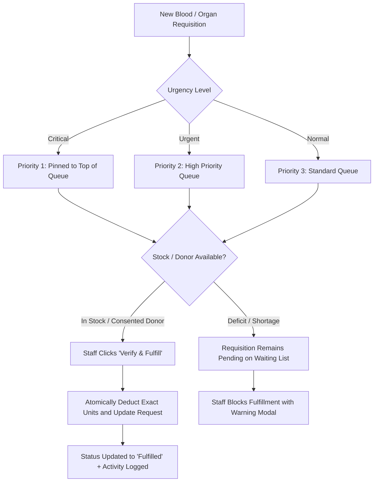
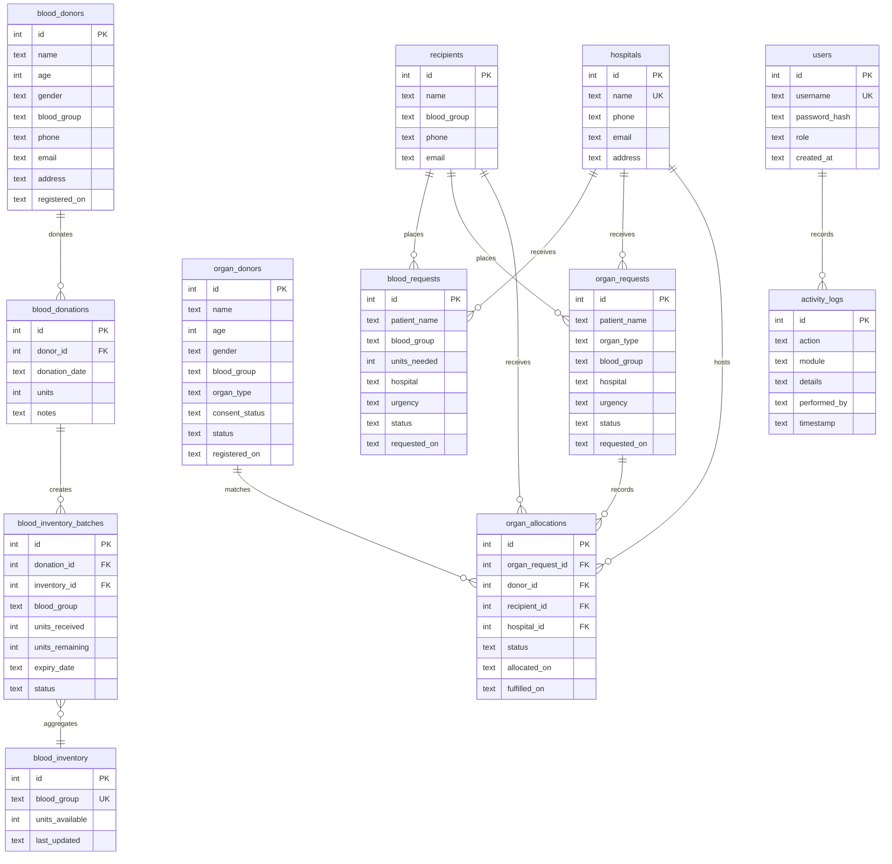

# 🏥 LifeLink — Blood Bank & Organ Donors Management System

> **Software Engineering Lab Project**  
> A clinical-grade desktop enterprise application for blood bank inventory management, organ donor pledge tracking, clinical urgency triage routing, and emergency medical requisition fulfillment. Built with **Python 3.11+**, **CustomTkinter**, **SQLite**, and distributed as a standalone **Windows `.exe`**.

---

## 🌟 Key Highlights & Engineering Features

- 🚨 **Automated Clinical Triage & Urgency Prioritization:**
  - SQL-driven priority ranking: **`Critical` (Priority 1) $\longrightarrow$ `Urgent` (Priority 2) $\longrightarrow$ `Normal` (Priority 3)**.
  - Emergency requisitions are pinned directly to the top of clinical tables with visual alert indicators (`🚨 Critical`, `⚠️ Urgent`).
- 🛡️ **Deficit Handling & Inventory Fulfillment Safeguards:**
  - **Demand Registration during Shortages:** Patients and hospitals can file requisitions even during zero-stock deficits to log unmet demand and alert emergency donation drives.
  - **Fulfillment Guards:** The system strictly blocks attempts to fulfill requests when available inventory is insufficient (e.g., requesting 3 units when only 1 is on hand).
  - **Automatic Stock Depletion:** Verified fulfillments automatically deduct the exact units from the real-time blood inventory and record the audit log.
- 🧾 **Normalized Recipient & Hospital Records:**
  - Blood and organ requests keep backward-compatible display fields while referencing reusable `recipients` and `hospitals` records.
  - Existing databases are migrated and backfilled automatically on startup.
- 🧪 **Traceable Blood Batches & Organ Allocations:**
  - Donations and manually added stock create FIFO inventory batches with collection and expiry dates.
  - Expired batches are automatically excluded from available stock and marked `Expired`.
  - Organ matching and fulfillment preserve donor-recipient-hospital allocation history.
- 🫀 **Organ Donor Registry & Bioethical Consent Tracking:**
  - Dedicated pledge management supporting Kidney, Liver, Heart, Lungs, Pancreas, Cornea, etc.
  - Explicit **Legal Consent Tracking** (`Pending`, `Consented`, `Withdrawn`) to ensure bioethical and legal compliance.
  - **Workflow Safeguards:** Consent, donor review, recipient-request review, and external transplant-authority authorization are recorded separately before an allocation can be reserved.
  - The application demonstrates administrative workflow only; it does not determine clinical eligibility, compatibility, transplant priority, or legal validity.
- 🖥️ **Modern Desktop UI & Micro-Interactions:**
  - Glassmorphism dark aesthetic: deep slate (`#0b0f19`), elevated card surfaces (`#131b2e`), and vibrant status accents.
  - **Animated Metric Counters:** Dashboard statistics count up smoothly from `0` to their real-time values.
  - **Dynamic Form Error Shake:** Form cards horizontally shake when an incorrect password or invalid input is entered.
  - **Live Digital Clock & Breadcrumbs:** Real-time system clock and user session badge (`👨‍⚕️ Admin` / `👨‍⚕️ Staff`).
  - **Visual Blood Reserves Panel:** Visual cards displaying available unit levels for all 8 blood groups at a glance.
- 🔐 **Enterprise Role-Based Authentication:**
  - Salted and hashed passwords utilizing the industry-standard **`bcrypt`** algorithm.
  - Multi-user support with built-in role separation (**Administrator**, **Medical Staff**, and **Medical Officers**).
  - Public registration creates **Staff Member** accounts only; privileged accounts can be created only by an authenticated Administrator through the service layer.
- 📊 **Clinical Auditing & One-Click CSV Export:**
  - Full audit trail (`activity_logs`) recording the active username, administrative action, and timestamp.
  - One-click CSV export for donors, donations, stock levels, requests, and activity logs.
- ✨ **Operator-focused UX:**
  - Paginated, sortable tables with clear empty states for large registries and filtered queues.
  - Dedicated read-only allocation history for donor, recipient, hospital, status, and timestamp traceability.
  - Recent activity surfaced on the dashboard and confirmation prompts for stock-changing operations.
- 📦 **Zero-Config Windows Deployment:**
  - Standalone `.exe` package generated with PyInstaller.
  - Runs natively on any 64-bit Windows PC without requiring Python, Git, or external dependencies.

---

## 🔐 Credentials & Access Control

The database is automatically initialized and pre-seeded on first launch. You can use the **⚡ Demo Quick Fill** buttons on the login screen or register your own staff account.

| Username | Password | Role | Permissions |
|:---|:---|:---|:---|
| `admin` | `admin123` | **Administrator** | Full access to manage donors, inventory, requests, audits, and users |
| `staff` | `staff123` | **Medical Staff** | Day-to-day operations, donor registration, triage, and status workflows |

> [!TIP]
> **Need a staff user?** Switch the tab on the login screen to **"Create Staff Account"**. Administrator and Medical Officer accounts cannot be self-created or promoted through public registration.

---

## 📋 Triage & Fulfillment Rules



---

## 🏗️ System Architecture & Modularity

The application follows clean **MVC (Model-View-Controller) / Service-Oriented Architecture** principles:

```
BloodBank-OrganDonor/
│
├── main.py                        # Application entry point & window controller
├── config.py                      # Centralized design tokens, constants & paths
├── requirements.txt               # Production dependencies
├── README.md                      # Comprehensive project documentation
│
├── database/
│   ├── connection.py              # SQLite connection manager & AppData persistence
│   ├── schema.sql                 # Relational schema, constraints, indexes & migrations
│   └── seed.py                    # Default data seeder (bcrypt admin/staff & stock)
│
├── models/                        # Data Access Layer (parameterized queries)
│   ├── user_model.py              # Account & credential queries
│   ├── donor_model.py             # Blood donor & donation audit models
│   ├── inventory_model.py         # Stock level calculations & arithmetic
│   ├── organ_donor_model.py       # Organ registry & consent status queries
│   ├── blood_request_model.py     # Blood demand records with triage sorting
│   ├── organ_request_model.py     # Organ proposals and approval-gated queues
│   ├── organ_workflow_model.py    # Reviews and external authorization records
│   ├── recipient_model.py         # Normalized recipient records
│   ├── hospital_model.py          # Normalized hospital records
│   ├── organ_allocation_model.py  # Donor-recipient allocation history
│   └── activity_log_model.py      # System audit logging
│
├── services/                      # Business Logic & Validation Layer
│   ├── auth_service.py            # Bcrypt hashing, session state & registration
│   ├── donor_service.py           # Biological verification & donation pipeline
│   ├── inventory_service.py       # Stock reservation & depletion guards
│   ├── organ_service.py           # Consent updates & donor eligibility
│   ├── blood_request_service.py   # Blood dispatch, triage & stock deduction
│   ├── organ_request_service.py   # Organ allocation & donor matching
│   └── export_service.py          # CSV generation & file dialogs
│
├── views/                         # Presentation Layer (CustomTkinter UI)
│   ├── login_view.py              # Modern authentication & registration portal
│   ├── dashboard_view.py          # Operational dashboard with animated metrics
│   ├── blood/                     # Blood donor CRUD & inventory views
│   ├── organ/                     # Organ donor CRUD & consent management
│   ├── requests/                  # Blood & organ emergency triage request views
│   ├── organ/allocation_history_view.py # Read-only allocation audit history
│   └── reports/                   # Reporting & CSV export center
│
├── components/                    # Reusable UI Component Library
│   ├── sidebar.py                 # Modern navigation drawer with user profile chip
│   ├── navbar.py                  # Header bar with live clock & breadcrumbs
│   ├── stat_card.py               # Glassmorphism cards with animated counters
│   ├── data_table.py              # Styled Treeview with paging, empty states & sorting
│   ├── form_fields.py             # Standardized form entries & dropdowns
│   └── dialogs.py                 # Native confirmation & notification modals
│
├── utils/                         # Utilities & Core Rules
│   ├── validators.py              # Regex & boundary checking (phone, email, age)
│   ├── constants.py               # Medical constants & table schemas
│   └── helpers.py                 # Date formatting & display generators
│
├── tests/                         # Comprehensive Unit Test Suite (51 Tests)
│   ├── test_auth.py               # Password hashing & verification tests
│   ├── test_validators.py         # Boundary & regex validation tests
│   └── test_donors.py             # Database CRUD & inventory integrity tests
│
└── dist/
    └── BloodBankManagerApp.exe    # Standalone Windows executable (~31.6 MB)
```

---

## 🗄️ Relational Database Schema (16 Tables)



The original eight operational tables remain compatible. The schema now also
contains:

| Table | Purpose |
|:---|:---|
| `recipients` | Independent patient/recipient records reused by requests |
| `hospitals` | Canonical hospital directory referenced by requests and allocations |
| `organ_allocations` | Durable donor-to-recipient allocation and status history |
| `blood_inventory_batches` | Donation-level stock tracking with FIFO consumption and expiry |
| `organ_donor_reviews` | Authorized administrative donor review decisions |
| `organ_request_reviews` | Authorized recipient/request review decisions |
| `transplant_authorizations` | External transplant-authority references and decisions |
| `organ_allocation_events` | Auditable allocation status transition history |

Organ allocation is intentionally a workflow demonstration. The application
records consent, administrative reviews, external authority references, and
status transitions; it does not make clinical eligibility, compatibility, or
transplant-priority decisions.

Database initialization enables foreign keys, adds missing nullable reference
columns to older databases, and backfills recipient/hospital references from
legacy request fields without deleting existing data.

---

## 🚀 Getting Started

### Option A: Run the Standalone Windows Executable (Recommended for Evaluation)
No installation required! Simply open the precompiled file:
```powershell
.\dist\BloodBankManagerApp.exe
```

### Option B: Run from Python Source
1. **Clone or navigate to the project directory:**
   ```powershell
   cd "d:\Projects\Blood Bank & Organ Donor Management"
   ```
2. **Set up a Python virtual environment (Python 3.11+):**
   ```powershell
   python -m venv venv
   .\venv\Scripts\activate
   ```
3. **Install required dependencies:**
   ```powershell
   pip install -r requirements.txt
   ```
4. **Launch the application:**
   ```powershell
   python main.py
   ```

---

## 🧪 Testing Strategy and Automated Test Suite

Run the canonical test command from the repository root:
```powershell
python -m unittest discover -s tests -v
```

The suite is organized by test level:

- **Unit tests:** password hashing, validators, model arithmetic, and CRUD behavior.
- **Integration tests:** donor registration → donation → inventory update; blood request → stock deduction → status update; and organ consent → review → matching → allocation.
- **System workflow tests:** critical user journeys in
  [`tests/test_critical_workflows.py`](tests/test_critical_workflows.py), executed in this order:
  1. Insufficient blood stock leaves the request pending.
  2. Withdrawn organ-donor consent blocks an existing allocation proposal.
  3. A matched donor cannot be allocated to a second request.
  4. An authenticated staff account cannot register an administrator.
  5. Invalid blood groups and negative quantities are rejected.
  6. Records remain available after database reinitialization.
- **Regression tests:** database migrations, FIFO batch consumption, audit logs, and allocation history.

The tests use isolated temporary SQLite databases, so test data is not written to
the operator's normal application database. Docker is not required for this
SQLite-backed test suite. Performance, security penetration, and usability
testing remain follow-up test layers; the current tests include role-authorization
and parameter-validation regression coverage.

---

## 📦 Building the Executable (`.exe`)

To compile the application from source into a single `.exe` file:
```powershell
pyinstaller --noconfirm --onefile --windowed `
    --name "BloodBankManagerApp" `
    --add-data "database/schema.sql;database" `
    --collect-all customtkinter `
    main.py
```
The output file will be generated in the `dist/` directory.

---

## 👨‍💻 Academic Project Submission
- **Subject:** Software Engineering Lab Project
- **Project Title:** Blood Bank & Organ Donors Management System
- **Deliverable:** Windows Executable (.exe) & Full Source Code
